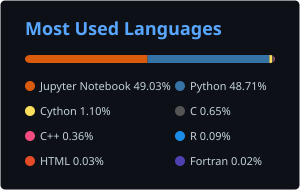

# Christopher Zerafa, PhD

**Head of Data at Block Labs. Data and AI leadership for regulated, real-money businesses.**

I build data platforms and the AI that runs on them, in businesses where every figure has to reconcile. LinkedIn has the career summary; this page is the hands-on side: what I build, what I write, and the students I supervise.

## Now

- **Head of Data, Block Labs** (2026–). Data platform for a multi-brand, crypto-first iGaming group: streaming change-data-capture into Kafka, Spark transformation, a ClickHouse warehouse and CI-gated data contracts, multi-tenant by configuration. Built with AI-assisted engineering by a deliberately small team, with the group's infrastructure and product engineers. The code is private.
- **Guest lecturer on applied AI**, University of Malta.

## Previously

- **Gaming Innovation Group** (2019–2026). Built the real-time data science platform, then led Data Science and Analytics and ran AI adoption across a 200-engineer organisation. +54% ARPU across AB-tested campaigns, +13% turnover per user; safer-gambling AI shortlisted at the EGR and Global Regulatory Awards.
- **Atlas Insurance** (2016–2019). Took a claims-recovery model to the board and recovered about €1M.
- **CGG** (2014–2016). Seismic imaging; reverse-time-migration work that cut GPU cost 75%.

## How I build

- A platform decision gets a cost line and a revenue or risk line before it gets an architecture diagram.
- Decisions are written down as architecture decision records and reviewed.
- Data contracts are enforced in CI, so bad data fails the build instead of landing in a report.
- Agents write a lot of the code; review gates, tests and runbooks decide what ships.

## Writing

On the [tech blog](https://zerafachris.github.io/bio/):

- [AI Isn't Killing SaaS. It's Killing the Moat.](https://zerafachris.github.io/bio/ai-saas-moat-open-source/) (Oct 2026)
- [One Senior Engineer Plus Agents Beats a Team of Four](https://zerafachris.github.io/bio/one-engineer-plus-agents/) (Oct 2026)
- [All posts](https://zerafachris.github.io/bio/posts/)

Also interviewed for iGamingBusiness's 2026 *AI Market Intelligence Report: Usage and Governance in Gaming*.

## Community

### PyMalta: Introduction to Machine Learning

[Repository](https://github.com/PyMalta/Introduction_to_ML_CZ)

A hands-on introduction to machine learning with Python: scikit-learn fundamentals, decision trees and hyperparameter tuning, ending in a mini-competition.

### G2Net Gravitational Wave Detection

[Kaggle competition](https://www.kaggle.com/competitions/g2net-gravitational-wave-detection)

Organised an international data science competition on detecting gravitational waves in noisy data, with the European Gravitational Observatory (EGO) and G2Net.

## [Publications & Research](https://scholar.google.com/citations?user=-bdKqmUAAAAJ&hl=en)

## Supervised Student Projects

### 2025

- **Sports Game Recommendation Engine Comparison** — Manuel Rasero

### 2024

- **Using AI Systems to Detect Problem Gamblers in Online Gaming** — Luke Pullicino, Dr Joel Azzopardi, Dr Christopher Zerafa

### 2023

- **Player Activity Clustering and Anomaly Detection** — Calvin Micallef, Dr Charlie Abela, Dr Christopher Zerafa
- **Developing Next-Generation Feature Store in Real-Time Streaming Big Data Environment** — Amadeusz Horzyk, Dr Charlie Abela, Dr Christopher Zerafa

### 2016

- **Petrophysical Study of the F3 Block within the Dutch Sector of the North Sea** — Bernard Pisani, Dr Godwin Debono, Dr Christopher Zerafa

## Education

- **PhD in Geophysics with Artificial Intelligence**, University of Malta
- **MSc in Exploration Geophysics**, University of Leeds (Distinction, first in class)
- **BSc in Mathematics and Physics**, University of Malta (First Class Honours)

## GitHub Stats

  
  

## Connect

- [LinkedIn](https://www.linkedin.com/in/christopherzerafa/)
- [Tech blog](https://zerafachris.github.io/bio/)
